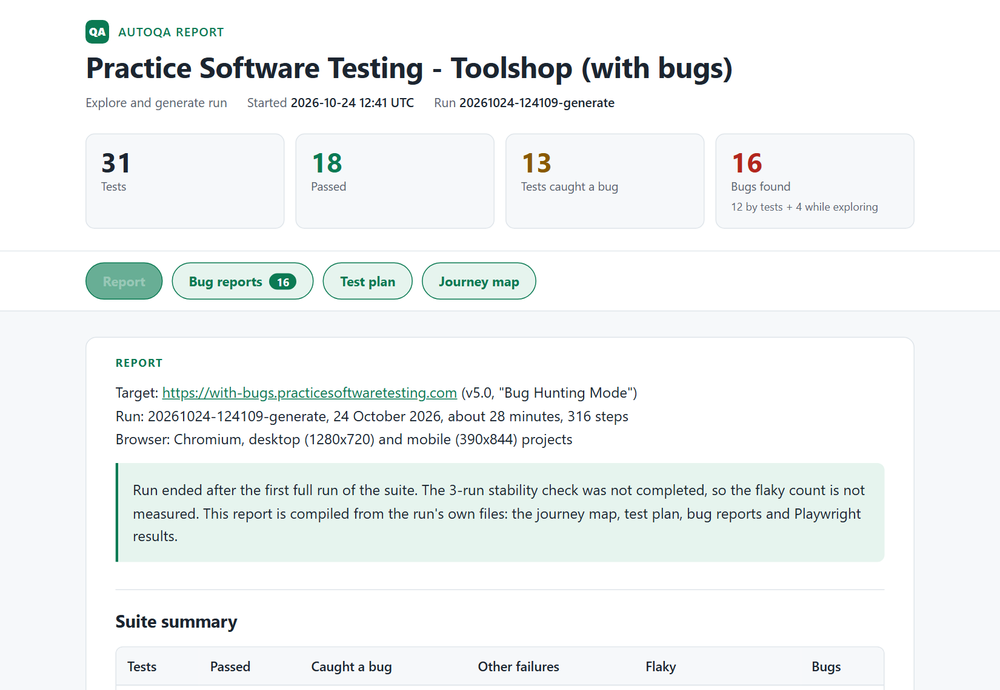

# AutoQA Agent

[](https://github.com/shaheryark789/autoqaagent/actions/workflows/ci.yml)

An AI testing agent built on Claude Code and Playwright. Give it the address of your web app and it works like a QA engineer who has just joined your team:

1. **Explores** the app in a real browser and maps its user journeys.
2. **Plans** what to test, rated by risk.
3. **Writes** a Playwright test suite, in a consistent house style.
4. **Runs** it, fixes its own test mistakes and reports the real bugs.
5. **Repairs** the tests when your UI changes, without hiding real bugs.

What you keep at the end is an ordinary Playwright suite that you own. Re-running it needs no AI and takes seconds.

## Watch a real run

https://github.com/user-attachments/assets/3f3170a0-df7d-4bb6-b2a5-b2446f6c61eb

A real run on [Toolshop](https://with-bugs.practicesoftwaretesting.com), a public practice shop built with deliberate bugs for testers to find. The agent had never seen it before. The video condenses the 28-minute run into 30 seconds: the agent explores the shop, writes 31 tests, runs them and writes up 16 bugs. If the video does not play here, [open it directly](https://github.com/user-attachments/assets/3f3170a0-df7d-4bb6-b2a5-b2446f6c61eb).

## A real report

| Tests | Passed | Caught a bug | Bugs found |
| --- | --- | --- | --- |
| 31 | 18 | 13 | 16 (12 by tests, 4 while exploring) |

Every test checks that the shop does the right thing. The 18 that passed cover features that work, such as sign-in, search and checkout. The other 13 caught a bug: each one is a real defect, confirmed and written up, not a broken test. The most serious ones:

| ID | Severity | Bug |
| --- | --- | --- |
| [BUG-01](examples/toolshop-2026-10-24/bugs/BUG-01-invoices-leak-other-customers.md) | critical | A new customer's invoice list includes other customers' invoices, with their addresses and payment details |
| [BUG-02](examples/toolshop-2026-10-24/bugs/BUG-02-profile-api-exposes-password-hash.md) | major | The profile data sent to the browser includes the password hash |
| [BUG-05](examples/toolshop-2026-10-24/bugs/BUG-05-sort-options-reversed.md) | major | Every sort option sorts in the opposite direction |
| [BUG-06](examples/toolshop-2026-10-24/bugs/BUG-06-checkout-postcode-missing-value.md) | major | Checkout fills the postcode with the text "missing value" |
| [BUG-13](examples/toolshop-2026-10-24/bugs/BUG-13-payment-fields-ignore-method.md) | major | Every payment method, even cash on delivery, asks for bank account details |

The full report, compiled from the run's own files, with all 16 bugs, the test plan and the journey map: [examples/toolshop-2026-10-24/report.md](examples/toolshop-2026-10-24/report.md).

**The suite it wrote** is in [examples/toolshop-2026-10-24/suite](examples/toolshop-2026-10-24/suite), exactly as the agent left it: 31 tests in 908 lines of TypeScript, with page objects, fixtures, role-based locators and no hard waits.

**Stable on re-runs, without the AI.** The agent's run stopped before its own stability check, so that check was finished afterwards. The suite ran 3 times in a row, unchanged, in about 2.5 minutes each and with no AI involved. **0 tests were flaky**: all 31 gave the same result every time. Two days after the agent's run, 2 checkout tests started failing because the shop's server rejects every order (HTTP 500). The tests were left asserting that an order goes through. Details: [stability.md](examples/toolshop-2026-10-24/stability.md).

The same report as one HTML page, which you can download, open, or print to PDF:



## Scored against the planted bugs

Toolshop's maintainers publish the [list of 94 bugs they planted](https://github.com/testsmith-io/practice-software-testing/blob/7766cb71f564c63c2a7f99180a46f089e0527199/sprint5-with-bugs/testSessions/listOfBugs.md), so the run can be scored against a real answer key, not just its own claims.

**All 16 bug reports describe a planted bug, so there were no false alarms. Together they cover 24 of the 94 (26%).** That share depends on what kind of bug it is:

| Kind of bug | Planted | Found |
| --- | --- | --- |
| Behaviour, data and text a user sees | 42 | 21 (50%) |
| Problems in the API responses the app loads | 4 | 2 (50%) |
| Accessibility: labels, alt text, contrast, keyboard order | 11 | 1 |
| Pixel-level layout, or only in Firefox or Edge | 27 | 0 |
| Needs deliberate attacks or crafted API calls | 9 | 0 |
| Only in emails the app sends | 1 | 0 |

The bottom three rows are outside what this run did. It used Chromium only and compared no screenshots, sent no attack payloads and read no email. The misses that were in reach are the next things to improve. For example, the agent never opened an invoice's own page, changed a profile, or tried uploading files on the contact form. The shop links to a "Bug Hunting Guide", and the agent chose not to open it because it would give away the answers. Every match was judged by hand after the run and is recorded with its reasoning, so it can be checked: [matches.json](examples/toolshop-2026-10-24/matches.json) and the full [score](examples/toolshop-2026-10-24/score.md), including each missed bug. CI re-scores the run on every push.

## Use it in four steps

You need [Node.js 22](https://nodejs.org), [Git](https://git-scm.com) and [Claude Code](https://code.claude.com) (`npm install -g @anthropic-ai/claude-code`, then run `claude` once to log in). The agent runs on a Claude subscription, so there is no API key to buy.

**1. Get the agent**

```bash
git clone https://github.com/shaheryark789/autoqaagent.git
cd autoqaagent
npm install
npx playwright install chromium
```

**2. Tell it where your app is**

Create a file named `.env` in the folder:

```
TARGET_URL=https://staging.your-app.com
```

If the app has a login, add a test account. The agent never sees the password (see [Credentials](#credentials)):

```
TEST_USERNAME=qa@your-company.com
TEST_PASSWORD='the password'
```

**3. Run it**

```bash
npm run generate:demo
```

A browser window opens so you can watch the agent work, next to a live panel that narrates every step. A first run takes roughly 15 to 25 minutes.

**4. Read the results**

- `runs/<run-id>/report.html`: the whole run in one page you can open, print to PDF or send to someone. It has the summary, every bug report with its screenshot, the test plan and the journey map.
- `runs/<run-id>/report.md`: the same report as Markdown, for reading in the repo or in a pull request.
- `runs/<run-id>/bugs/`: one report per real bug, with steps to reproduce.
- `generated-tests/`: the Playwright suite. Run it again any time with `npm test`.

That is the whole loop. When your app changes later, one more command repairs the suite:

```bash
npm run heal:demo
```

## What you get

| Output | What it is |
| --- | --- |
| Journey map | The app's routes and user journeys as the agent found them, with the exact element names tests will use |
| Test plan | Test cases rated by risk, including what it decided not to test and why |
| Playwright suite | Page objects and specs: role-based locators, no hard waits, no CSS selectors |
| Bug reports | One per real defect: severity, steps to reproduce, expected and actual result, evidence |
| Run report | Suite summary with a flaky count from repeated runs, the meaning of every failure, the bug list. Written as Markdown and as one self-contained HTML page |
| Replayable log | Every step the agent took, viewable in the live panel afterwards |

## How it works

The agent is [Claude Code](https://code.claude.com) running without a chat window, driving a real browser through [Playwright MCP](https://github.com/microsoft/playwright-mcp). Its QA judgment is written down as skills.

| Piece | Where | Role |
| --- | --- | --- |
| Runner | `bin/autoqa.mjs` | Starts the agent, locks its browser to your app's address and records every step |
| Rules | `CLAUDE.md` | Stay on the target, use test data only, never weaken a test to hide a bug, narrate each step |
| Skills | `.claude/skills/` | How to explore an app, design tests by risk, write Playwright in the house style, and tell a broken test from a real bug |
| Live panel | `bin/panel.mjs` | A local page showing each step as it happens, or replaying a past run |

**The skills are the product.** They hold the method: what to test first, which locators survive a redesign, what counts as a bug. Tailoring them to a team's own standards changes how the agent works without touching the code.

## Self-healing

UI changes are the main reason test suites rot. `npm run heal` re-runs the suite against the changed app, reproduces each failure in the browser and sorts it into one of two kinds:

- **The test broke** (a renamed button, a moved field, changed test data): it repairs the test, in the page object where the locator lives.
- **The app broke** (a real defect): it leaves the test failing, unchanged, and writes a bug report.

The second half matters as much as the first. A tool that makes every red test green hides the bugs the suite exists to catch.

**Tried on Toolshop:** three locators in the suite were renamed on purpose to simulate a UI change. Nobody told the agent what changed. It repaired exactly those three lines, in the page objects, and left all 15 tests that fail on real bugs failing. It also refused to paper over 4 flaky tests with retries, because the shop itself had stopped serving pages. The full run: [examples/toolshop-heal-2026-10-26](examples/toolshop-heal-2026-10-26).

## Credentials

For apps with a login, the agent signs in with a test account without being given its password:

- **The agent only knows the names.** It types the text `TEST_USERNAME` and `TEST_PASSWORD`, and its browser swaps in the real values and masks them in everything the agent reads back.
- **They stay out of the logs** and the live panel: the runner replaces the values with their names.
- **They stay out of the tests.** The suite reads them from the environment at run time. A setup step signs in once and the signed-in tests reuse that session.
- **The agent cannot open your settings files.** Git ignores them too, so they are never committed.

This keeps credentials out of the AI's view, the logs and the repo. It is not a hard security boundary, because the tests themselves need the password to sign in. Use a low-privilege test account on a test environment, never a real user's or an admin's.

Before a full run, `npm run check-login` confirms in about a minute that the test account can sign in.

## What it can and cannot test

**It works on** web apps reachable in a browser, at desktop and phone screen sizes, with or without a login.

**It does not handle:**

- native mobile or desktop apps;
- sign-in that needs a CAPTCHA, a one-time code (2FA) or an email link;
- sign-in through another site, such as Google or Microsoft;
- very large apps in full: it covers the main journeys, not every page.

**Point it at a test environment.** The agent creates accounts and places orders, so it should never run against production or real customer data.

## Your tests stay yours

This repo contains the agent and nothing else. The tests and reports it writes for an app are never added here: they belong to that app's owner and are kept separately and privately. The only exception is the sample run in `examples/`, on a public practice site.

## Commands

```bash
npm run generate:demo    # explore, write and run tests, with a visible browser and the live panel
npm run generate         # the same, in the background
npm run heal:demo        # repair the suite after the app changed, with browser and panel
npm run heal             # the same, in the background
npm run check-login      # confirm the test account can sign in
npm test                 # replay the suite, no AI involved
npm run test:ui          # replay it in Playwright's UI mode
npm run report:html      # build and open the run report as one HTML page (newest run, or name a run id)
npm run report           # open Playwright's own HTML test report
npm run panel            # open the live panel and replay a past run
npm run score -- <run>   # score a run against an app's planted-bug list (needs the run's matches.json)
npm run test:unit        # the agent's own unit tests
```

**Other settings**, all optional and listed in `.env.example`:

- `LOGIN_URL`: the sign-in page, if it is hard to find from the app's navigation.
- `ALLOWED_ORIGINS`: other addresses your app needs, such as an API on a different host. The agent's browser blocks everything except your app's address and these.
- `EXCLUDED_PATHS`: routes the agent must leave alone. To add them, open the app's settings file (`.env.<name>`, or `.env`) and list the paths with commas between them, for example `EXCLUDED_PATHS=/internal,/api/billing`. Each path starts with `/` and covers everything under it. For a single run, pass `--exclude /internal,/api/billing` instead. Nothing else is skipped, so an admin area you do not list gets tested, and the report names the routes that were left out.
- `MAX_MINUTES` and `MAX_TURNS`: the run limits. Every run stops by itself when it reaches either one, so a run that gets stuck or keeps repeating a step cannot go on for hours. A turn is one step the agent takes, such as opening a page or writing a file. The defaults are 60 minutes and 500 turns for `generate`, 30 and 300 for `heal`, and 5 and 40 for `check-login`, about three times a normal run. To change them, set them in the app's settings file, for example `MAX_MINUTES=120` and `MAX_TURNS=900`, or pass `--max-minutes 120 --max-turns 900` for a single run. A stopped run keeps what it wrote and says which limit it reached.
- `STABILITY_RUNS`: the stability check. Once the suite is written and every failure is explained, the agent runs it three times in a row and compares the results. A test that passes on one run and fails on another is flaky: the agent fixes it and repeats the runs, so every report states how many tests are flaky and how many runs that rests on. To change the number, set for example `STABILITY_RUNS=5` in the app's settings file, or pass `--stability-runs 5` for a single run. `1` switches the check off.
- `WORKERS`: how many browsers run tests at once. Lower it, for example `WORKERS=2`, for a shared public app that slows down or returns errors under a burst of traffic.
- **Several apps:** give each its own settings file, `.env.<name>`, and add `--site <name>` to a command.

## Testing the agent itself

The agent's own code is tested too: `npm run test:unit` runs about 50 unit tests with Node's built-in test runner, no extra dependencies. They cover the parts that must not fail quietly:

- **Secrets stay hidden:** the redactor replaces the test account's values in logs, including inside JSON and when one value contains the other.
- **The report is safe and honest:** HTML quoted from the app under test is shown as text, never run. A test that caught a bug is never counted as a failure. Counts still come out right for older runs without `summary.json`.
- **Settings resolve in a fixed order:** flag, then environment, then site file, then `.env`. Bad limits and malformed routes are rejected.
- **The score cannot drift:** every bug report must be accounted for, and unknown bug IDs are rejected.

[CI](.github/workflows/ci.yml) runs them on Linux and Windows on every push, since the runner has Windows-specific process handling.

## Licence

[MIT](LICENSE). The tests and reports it writes for your app are yours.
